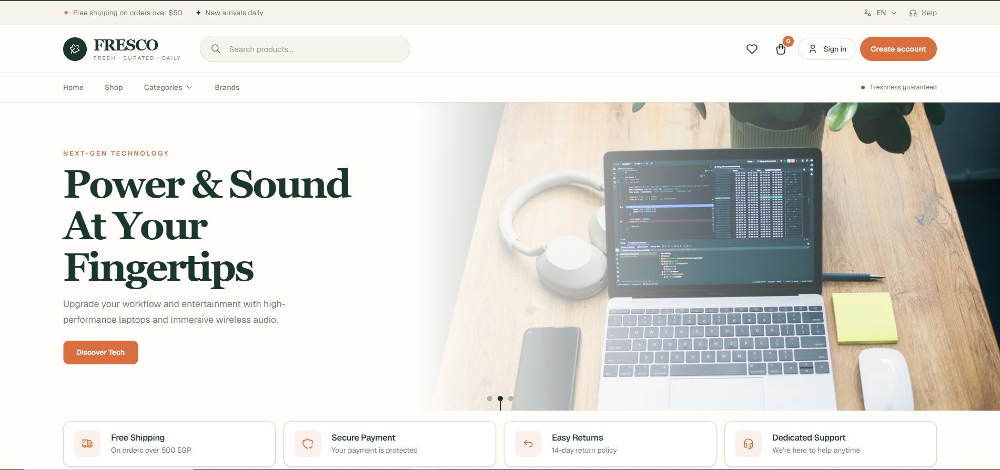
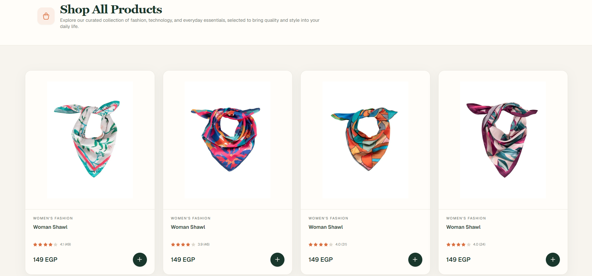
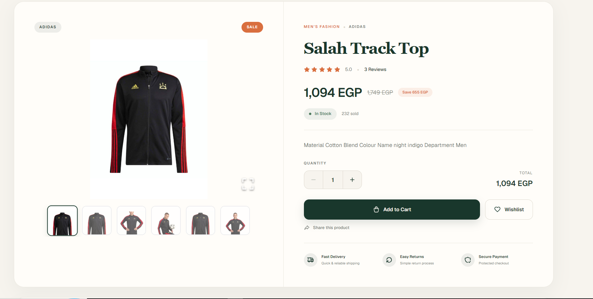
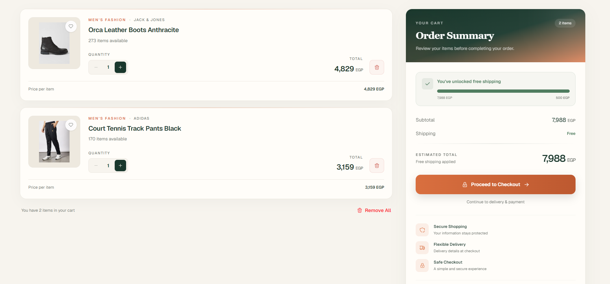
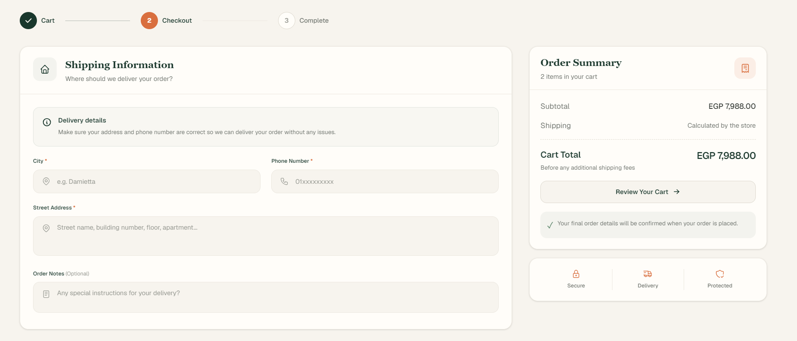

# FRESCO — Modern E-Commerce Storefront

A modern, bilingual e-commerce storefront built with Next.js, TypeScript, and Tailwind CSS. FRESCO features a clean shopping experience with Arabic and English support, responsive layouts, product discovery, cart management, and a streamlined checkout flow.

## 🔗 Live Demo

**[Explore FRESCO](https://fresco-next-ecommerce-w6pf.vercel.app/en)**

## 📸 Screenshots

### Homepage


### Shop & Product Listing


### Product Details


### Shopping Cart


### Checkout


> Screenshots will appear here after adding the corresponding image files to the repository.

## ✨ Features

- **Bilingual Interface:** Arabic and English localization with RTL/LTR layout support.
- **Product Discovery:** Browse products, categories, and brands.
- **Product Details:** View product information, images, pricing, and discounts.
- **Shopping Cart:** Review cart items and manage the checkout process.
- **Checkout Flow:** Enter shipping details and choose an available payment method.
- **Authentication:** Login and registration flows.
- **Responsive Design:** Adaptable layouts for desktop, tablet, and mobile screens.
- **Reusable Components:** Consistent UI components and organized feature-based code.
- **API Integration:** Fetch and manage product and shopping data through API requests.

## 🛠️ Tech Stack

- **Framework:** Next.js (App Router)
- **Library:** React
- **Language:** TypeScript
- **Styling:** Tailwind CSS
- **Internationalization:** next-intl
- **State Management:** Redux Toolkit
- **Data Fetching & Caching:** TanStack Query
- **Forms & Validation:** React Hook Form, Zod
- **HTTP Requests:** Axios
- **Notifications:** Sonner
- **Deployment:** Vercel

## 🏗️ Architecture

The project uses the Next.js App Router and a feature-based structure to organize pages, UI components, schemas, state management, and server actions.

- **App Router:** Organizes application routes and localized pages.
- **Feature-Based Structure:** Groups related functionality into dedicated modules.
- **Redux Toolkit:** Manages shared client-side state, including cart data.
- **TanStack Query:** Supports API data fetching and caching.
- **React Hook Form & Zod:** Handle form state and validation.
- **next-intl:** Provides localized routing and translations.

## 🚀 Getting Started

### Prerequisites

- Node.js
- npm
- Access to the API used by the application

### Installation

1. Clone the repository:

   ```bash
   git clone https://github.com/RaniaGabal51/fresco-next-ecommerce.git
   ```

2. Navigate to the project directory:

   ```bash
   cd fresco-next-ecommerce
   ```

3. Install dependencies:

   ```bash
   npm install
   ```

4. Configure the required environment variables according to the project's API configuration.

5. Start the development server:

   ```bash
   npm run dev
   ```

6. Open [http://localhost:3000](http://localhost:3000) in your browser.

## 🌐 Localization

FRESCO supports two languages:

- English (`/en`)
- Arabic (`/ar`)

The interface supports left-to-right (LTR) and right-to-left (RTL) layouts based on the selected locale.

## 📂 Repository

[View the source code on GitHub](https://github.com/RaniaGabal51/fresco-next-ecommerce)

## 👩‍💻 Developer

**Rania Reda Gabal**

- GitHub: [@RaniaGabal51](https://github.com/RaniaGabal51)
- LinkedIn: [Connect with me](https://www.linkedin.com/in/rania-gabal/)

---

*FRESCO is a portfolio project built to practice modern e-commerce development with Next.js, TypeScript, and a reusable component architecture.*